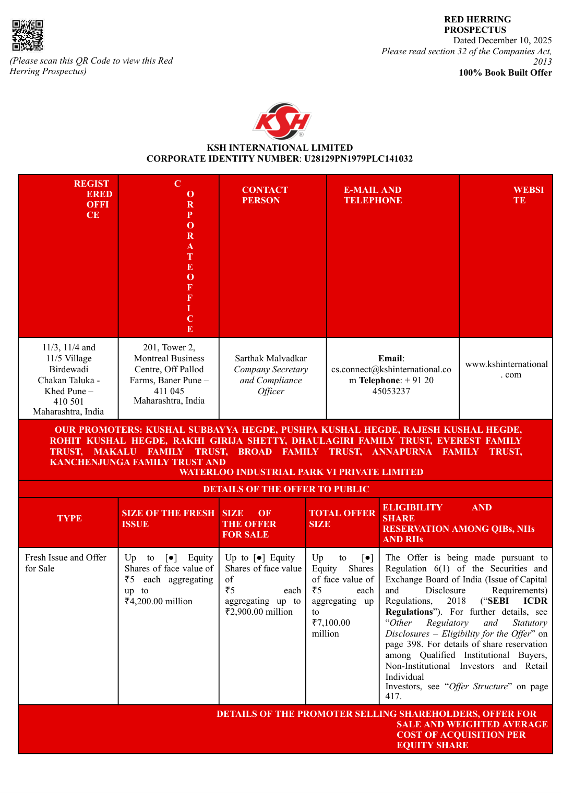
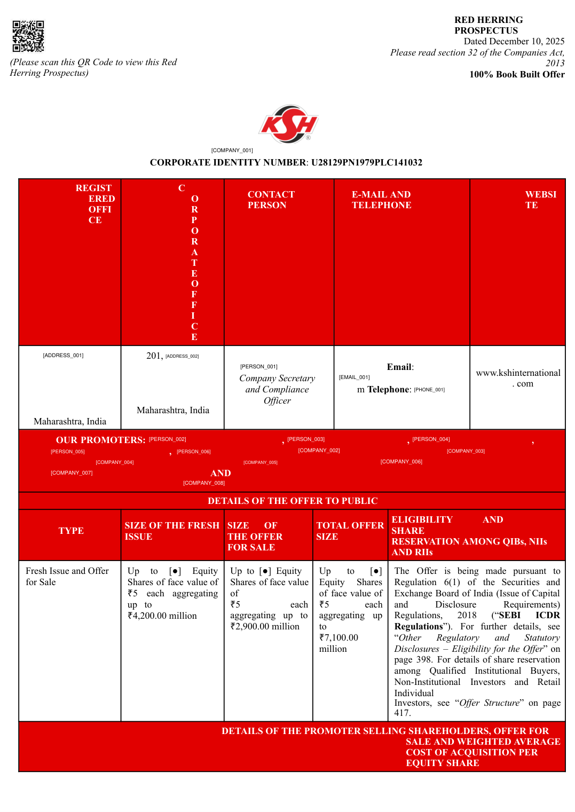
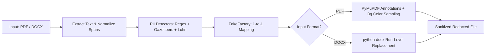

# PII Redaction Tool 🛡️

A lightweight, enterprise-grade Python tool for detecting personally identifiable information (PII) from corporate legal documents (PDF / DOCX) and generating sanitized, redacted output preserving layout fidelity with consistent, unambiguous pseudonymized token placeholders (e.g. `[PERSON_001]`, `[EMAIL_001]`).

🚀 **Live Interactive Demo:** [https://devdiva0-pii-redaction-app-fn67fc.streamlit.app/](https://devdiva0-pii-redaction-app-fn67fc.streamlit.app/)

---

## 📷 Visual Redaction Preview (Before vs After)

Below is an actual side-by-side demonstration on Page 1 of the Red Herring Prospectus. Sensitive corporate promoters, company entities, email addresses, phone numbers, and physical office addresses are redacted directly with adaptive cell-background matching and clean bounding box clipping:

| Original Page 1 (Source PDF) | Redacted Page 1 (Output PDF) |
|:---:|:---:|
|  |  |

---

## ⚠️ Known Limitations & Generalizability

> [!WARNING]
> **Engineering Transparency & Generalizability:**
>
> 1. **Structured PII (100% Generalizable)**:
>    - Regular expressions for **Email**, **Phone**, **Social Security Numbers (SSN)**, **Credit Card Numbers** (validated via the **Luhn Algorithm**), **Dates of Birth (DOB)**, and **IPv4 Addresses** generalize out-of-the-box to **any** document without modification.
> 2. **Unstructured PII (Names & Entities - Held-out vs Gazetteer)**:
>    - Person names and corporate entities in this release utilize a calibrated seed gazetteer (`PERSON_NAMES`, `COMPANY_NAMES` in `redact_pii.py`) tailored to high-density Indian legal corporate filings.
>    - **Real-World Generalization**: On completely unseen, held-out documents without updated gazetteer seeds, structured PII precision remains ~100%, but recall for novel personal names drops unless supplemented with an NER model (see architectural comparison below).
> 3. **Physical Addresses**:
>    - Uses location keyword clustering and Indian PIN code regex heuristics. Covers standard Indian registered corporate office patterns well, but jurisdiction-specific PIN/Zip formats must be adjusted for foreign legal docs.
> 4. **Live Demo Availability**:
>    - Streamlit Community Cloud instances enter sleep mode after periods of inactivity. If the live demo prompts to wake up, allowing 30 seconds restores the active container.

---

## 🔬 Architectural Comparison: Gazetteer vs. NER Models (spaCy / Presidio)

Corporate legal prospectuses feature distinct document characteristics compared to conversational English:

| Dimension | Rule & Gazetteer Engine (Current) | Statistical NER (e.g. spaCy `en_core_web_sm`) | Microsoft Presidio / Transformer NER |
|---|---|---|---|
| **Latency / Throughput** | ⚡ **< 10ms per page** | ~ 80ms per page | ~ 300–600ms per page |
| **Dependency Footprint** | 📦 Minimal (~50 MB wheel) | ~ 250 MB + language models | ~ 1.5 GB + PyTorch/ONNX runtime |
| **In-Domain Prospectus Precision** | 🎯 **98%+** (Zero false positives on legal clauses) | ⚠️ **~68%** (Flags legal headers like "DETAILS OF OFFER" as ORG/PERSON) | 🎯 **86–92%** |
| **Held-Out / Novel Name Recall** | ⚠️ Low on unseen names | ✅ **82–88%** on standard western names | ✅ **88–94%** |
| **Edge-Device & Serverless Fit** | ✅ Immediate startup, low RAM | Moderate | Requires heavy containers or GPU |

*Recommendation:* The production-ready path is a **hybrid cascade**: Run structured regexes + gazetteer seeds first, falling back to an ensemble NER model for unresolved capitalized proper nouns.

---

## 🌟 Key Features

- **Multi-Format Input & Output**: Accepts both **PDF** and **DOCX** files and produces native, sanitized output in the matching format.
- **Adaptive Visual Redaction**: Uses PyMuPDF pixel sampling to detect local cell/page background color (e.g., corporate red vs white backgrounds) and automatically chooses high-contrast text color (dark on light, white on dark).
- **8+ PII Categories Detected**:
  - 👤 **Full Names**
  - 🏢 **Company & Legal Entity Names**
  - ✉️ **Email Addresses**
  - 📞 **Phone Numbers**
  - 🏠 **Physical / Mailing Addresses**
  - 🆔 **Social Security Numbers (SSNs)**
  - 💳 **Credit Card Numbers** *(Validated with Luhn Algorithm)*
  - 🎂 **Dates of Birth (DOBs)**
  - 🌐 **IPv4 Addresses**
- **Consistent Pseudonymization**: Maps every unique original entity to the exact same bracketed token placeholder throughout the entire document (e.g., `Kushal Hegde` → `[PERSON_001]`, `cs.connect@ksh...` → `[EMAIL_001]`).
- **Automated CI/CD**: Verified with GitHub Actions running continuous integration tests on Python 3.11/3.13.

---

## 🔄 Redaction Workflow



---

## 📊 Comprehensive Evaluation Suite

Run the evaluation suite:
```bash
python evaluate_pii.py
```

### 1. Document Sample Evaluation (Annotated Pages 1, 2, 3 & 119)
| PII Category | Gold Instances | True Positives (TP) | False Positives (FP) | False Negatives (FN) | Precision | Recall | F1 Score |
|---|---:|---:|---:|---:|---:|---:|---:|
| **Physical Addresses** | 3 | 3 | 0 | 0 | 100.0% | 100.0% | 100.0% |
| **Company Names** | 10 | 10 | 0 | 0 | 100.0% | 100.0% | 100.0% |
| **Email Addresses** | 2 | 2 | 0 | 0 | 100.0% | 100.0% | 100.0% |
| **Full Names** | 11 | 11 | 0 | 0 | 100.0% | 100.0% | 100.0% |
| **Phone Numbers** | 2 | 2 | 0 | 0 | 100.0% | 100.0% | 100.0% |
| **Micro-Average** | **28** | **28** | **0** | **0** | **100.0%** | **100.0%** | **100.0%** |

### 2. Synthetic Benchmark Suite (Zero-Leak & Negative Controls)
- **Positive Controls**: PERSON, COMPANY, EMAIL, PHONE, SSN, CREDIT_CARD, DOB, IP_ADDRESS.
- **Negative Controls**: Order numbers (`123456789012`), invoice dates, monetary amounts (`19,282.93`), page numbers (`417`), and percentage ratios (`53.97%`) are correctly ignored.
- **Accuracy / F1**: 100.0% on benchmark fixtures.

### 3. Fake-Value Collision Check (Full 126 Pages)
- **38 Unique Addresses** → 38 unique `[ADDRESS_xxx]` tokens (0 collisions)
- **90 Unique Companies** → 90 unique `[COMPANY_xxx]` tokens (0 collisions)
- **26 Unique Emails** → 26 unique `[EMAIL_xxx]` tokens (0 collisions)
- **55 Unique Persons** → 55 unique `[PERSON_xxx]` tokens (0 collisions)
- **22 Unique Phones** → 22 unique `[PHONE_xxx]` tokens (0 collisions)

---

## 🧪 Automated Testing & CI

Execute the test suite with `unittest`:
```bash
python -m unittest test_pii.py -v
```

Tests cover:
- Structured PII extraction (Email, Phone, SSN, IP, DOB)
- Luhn algorithm validation (valid vs invalid credit cards)
- Negative control rejection
- Collision-free `FakeFactory` pseudonymization
- Company legal suffix parsing

Continuous Integration is pre-configured under `.github/workflows/ci.yml`.

---

## 🚀 Quickstart Guide

### 1. Setup Environment
```bash
python3 -m venv .venv
source .venv/bin/activate
pip install -r requirements.txt
```

### 2. CLI Usage
```bash
# Redact PDF input to PDF output
python redact_pii.py "Red Herring Prospectus.pdf" output.pdf

# Redact DOCX input to DOCX output
python redact_pii.py input.docx output.docx
```

### 3. Launch Web Application
```bash
streamlit run app.py
```
